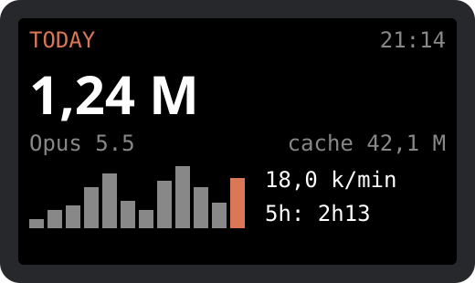

# Claude Code Token Monitor for M5Stack Cardputer

**A pocket-sized desk display for your Claude Code token usage.** See today's tokens, burn rate and your estimated 5-hour window at a glance, on an ESP32-S3 Cardputer connected by USB.



*Illustrative mockup with sample numbers.*

## Features

- **Pixel mascot:** walks while Claude works, jumps when it needs you, panics on alerts, sleeps when idle
- **Agent status:** working, idle or waiting for permission, with a beep when it needs you
- **Approve from the device (opt-in):** press `y` twice to allow, `n` to deny
- **Estimated cost:** today, week and session at API list prices
- **Burn rate and forecast:** tokens per minute and a 2-hour projection
- **Alerts:** daily token goal and 5-hour window running out
- **Project ranking and parallel sessions**
- **Streak, record and 28-day heatmap**
- **Themes:** Claude, Retro and Matrix
- **USB or Wi-Fi:** Wi-Fi is display-only and sends totals only
- **microSD history:** daily totals in `token-history.csv` (FAT32)

## Keys

| Key | Action |
| --- | --- |
| Any other key / `,` | Next / previous view |
| `t` | Next theme |
| `m` | Mute |
| `p` | Pause updates |
| `1`-`9` | Run a command from your config |
| `y` `y` / `n` | Approve / deny a pending request |

## Requirements

- M5Stack Cardputer (ESP32-S3)
- PC running [Claude Code](https://claude.com/claude-code). Developed on Linux; macOS and Windows are untested
- [uv](https://docs.astral.sh/uv/) and a USB-C data cable

## Quick start

```bash
git clone https://github.com/Evaldoes/cardputer-token-monitor.git
cd cardputer-token-monitor

# Back up your current firmware: flashing replaces it, including any launcher
mkdir -p backup
uvx esptool --port /dev/ttyACM0 read-flash 0 0x800000 backup/firmware-original-8MB.bin

# Flash and start sending data
(cd firmware && uvx --from platformio pio run -t upload --upload-port /dev/ttyACM0)
uv run --with pyserial bridge/token_bridge.py
```

The bridge finds the device automatically; use `--port` to override it. To preview the data without a device, run `python3 bridge/token_bridge.py --once`.

To restore your firmware:

```bash
uvx esptool --port /dev/ttyACM0 write-flash 0 backup/firmware-original-8MB.bin
```

Never publish `backup/`: it may contain Wi-Fi passwords. It is already in `.gitignore`.

## Optional setup

```bash
python3 scripts/install_hooks.py            # agent status (backs up ~/.claude/settings.json)
python3 scripts/install_hooks.py --approve  # also approve from the device
python3 scripts/install_hooks.py --remove   # undo
./scripts/install_service.sh                # start on login (Linux, systemd)
uv run --with pyserial bridge/token_bridge.py --port /dev/ttyACM0 --wifi "MyNetwork"  # store Wi-Fi on the device (add --port)
```

**About `--approve`:** run `uv run --with pyserial bridge/token_bridge.py --pair` first; an unpaired device can't approve or run commands. Only short, single-line Bash commands shown in full can be approved; anything else can only be denied on the device or answered in the terminal. Approval is a convenience, **not a security boundary:** decisions travel through files owned by your user, so any process running as you, including one started by Claude, could forge a response. The USB serial number used for pairing can be spoofed, so it only prevents mix-ups. Don't enable approval if that matters to you. Each permission request first waits up to 25 s for the device, delaying the terminal prompt. With no answer, or with the bridge stopped, the decision goes back to the terminal; it never approves by default. Anyone holding the device can approve commands on your PC, so enable it only if that is acceptable.

Config lives in `~/.config/cardputer-token-monitor.json`:

```json
{
  "goal_daily_tokens": 2000000,
  "window_warn_minutes": 30,
  "wifi_broadcast": false,
  "commands": {"1": ["notify-send", "Hello from the Cardputer"]}
}
```

Commands run on your PC without a shell, and only those you list. Wi-Fi updates are unauthenticated broadcasts: anyone on your network can read the totals or spoof the display, so they never carry project names or approvals, and the device ignores their lists and never writes them to the microSD.

## Web installer

After GitHub Pages is enabled, `.github/workflows/pages.yml` builds the firmware and publishes the installer from `site/` (Chrome or Edge).

## How it works

```text
~/.claude/projects/**/*.jsonl -> bridge/token_bridge.py -> USB serial (JSON, every 5 s) -> Cardputer
```

## What the numbers mean

- **Total:** input + output + cache creation. Cache reads appear separately.
- **5h:** an estimate from your local logs, not your plan's real limit.
- **Cost:** an estimate at list prices in `bridge/token_bridge.py`, not your bill. Unknown models count as $0.
- **Forecast:** today so far plus the last hour's rate for up to 2 more hours.
- **Scope:** Claude Code on this PC only, excluding claude.ai and other machines.
- **No percentage of your plan limit:** the local logs used here don't provide it.

## Tests

```bash
uvx pytest tests
```

## Contributing

Issues and pull requests are welcome, especially Cardputer ADV, macOS and Windows reports.

## License

[MIT](LICENSE). Independent community project, not affiliated with Anthropic or M5Stack.

---

🇧🇷 **Em português:** monitor do consumo de tokens do Claude Code na tela do M5Stack Cardputer, conectado por USB. Siga o *Quick start* acima.
