# Monitor de tokens do Claude Code para M5Stack Cardputer

**Um companheiro de mesa, de bolso, para o Claude Code.** Veja seus tokens, o custo estimado e o status do agente em um Cardputer com ESP32-S3, e cuide de um bichinho em pixel art que sobe de nível enquanto você trabalha.

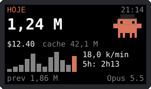

*Ilustração com números de exemplo. As telas reais têm mais detalhes.*

🇺🇸 [Read in English](README.md)

## Índice

- [Funcionalidades](#funcionalidades)
- [Requisitos](#requisitos)
- [Início rápido](#início-rápido)
- [Galeria de telas](#galeria-de-telas)
- [Telas](#telas)
- [Teclas](#teclas)
- [Bichinho virtual](#bichinho-virtual)
- [Hooks do Claude Code](#hooks-do-claude-code)
- [Tudo o que dá para configurar](#tudo-o-que-dá-para-configurar)
- [Wi-Fi](#wi-fi)
- [Histórico no microSD](#histórico-no-microsd)
- [Aprovar pelo aparelho](#aprovar-pelo-aparelho)
- [O que os números significam](#o-que-os-números-significam)
- [Como funciona](#como-funciona)
- [Privacidade e segurança](#privacidade-e-segurança)
- [Solução de problemas](#solução-de-problemas)
- [Desinstalação](#desinstalação)
- [LilyGO T-Embed](#lilygo-t-embed)
- [Estado do projeto](#estado-do-projeto)
- [Desenvolvimento](#desenvolvimento)

## Funcionalidades

- **Mascote em pixel art:** anda quando o Claude trabalha, pula quando precisa de você, entra em pânico com alertas e dorme quando não há sessão ativa ou o PC para de enviar dados
- **Bichinho virtual:** alimente, brinque, faça carinho e coloque o mascote para dormir; ele sobe de nível conforme você usa tokens e nunca morre
- **Minijogo e acessórios:** um jogo de pular, além de chapéu, óculos e coroa liberados por nível
- **Reações:** comemora tarefas concluídas e se assusta com ferramentas que falham
- **Status do agente:** trabalhando, parado ou aguardando permissão, com um aviso sonoro quando precisa de você
- **Custo estimado:** hoje, semana e sessão, pelos preços de tabela da API
- **Ritmo e previsão:** tokens por minuto e uma projeção de 2 horas
- **Alertas:** orçamento diário, meta diária de tokens e fim da janela de 5 horas
- **Rankings:** principais projetos, uso por modelo e comparação entre semanas
- **Sessões paralelas:** status e ferramenta atual de até 4 sessões
- **Sequência, recorde e mapa de atividade de 28 dias**
- **Pomodoro:** ciclos de 25 minutos de foco e 5 de pausa
- **10 temas e 8 cores de mascote**, escolhidos separadamente
- **3 idiomas:** português, inglês e espanhol
- **Configurações no aparelho:** não precisa do PC para mudar o visual ou entrar no Wi-Fi
- **USB ou Wi-Fi:** dados completos pela USB e só totais pelo Wi-Fi
- **Tela com tempo limite:** a primeira tecla só acende a tela, para nada ser acionado às cegas
- **Histórico no microSD:** totais diários em um arquivo CSV
- **Teclas de atalho:** `1` a `9` rodam no PC os comandos que você escolher
- **Aprovação pelo aparelho:** opcional, desligada por padrão e sem valor como proteção de segurança

## Requisitos

- M5Stack Cardputer (ESP32-S3, flash de 8 MB)
- PC com [Claude Code](https://claude.com/claude-code). Desenvolvido no Linux; macOS e Windows não foram testados
- [uv](https://docs.astral.sh/uv/) e um cabo USB-C que transmita dados
- No Linux, acesso à porta serial (normalmente pelo grupo `dialout`)
- Opcional: cartão microSD em FAT32 e uma rede Wi-Fi de 2,4 GHz

## Início rápido

O jeito mais fácil, no Linux:

```bash
git clone https://github.com/Evaldoes/cardputer-token-monitor.git
cd cardputer-token-monitor
./setup.sh
```

Ele verifica os requisitos, faz backup do firmware, grava, pareia, instala os hooks, pergunta os alertas e ativa o início automático, confirmando cada etapa. Pode ser rodado de novo sem problema.

| Opção | Para que serve |
| --- | --- |
| `--yes` | Aceita todas as etapas sem perguntar |
| `--no-flash` | Só configura o PC, sem backup nem gravação |
| `--approve` | Permite aprovar pelo aparelho; sempre pede uma confirmação digitada |
| `--port PORTA` | Porta serial, detectada por padrão |
| `--dry-run` | Mostra o que faria, sem alterar nada |

Ele não formata o microSD, não entra no Wi-Fi e não adiciona você ao grupo `dialout`.

### Configuração manual

```bash
git clone https://github.com/Evaldoes/cardputer-token-monitor.git
cd cardputer-token-monitor

# 1. Faça backup do firmware atual: a gravação o substitui, incluindo qualquer launcher
mkdir -p backup
uvx esptool --port /dev/ttyACM0 read-flash 0 0x800000 backup/firmware-original-8MB.bin

# 2. Grave o firmware
(cd firmware && uvx --from platformio pio run -t upload --upload-port /dev/ttyACM0)

# 3. Pareie, para o aparelho receber dados de projetos e sessões
uv run --with pyserial bridge/token_bridge.py --pair

# 4. Envie os dados
uv run --with pyserial bridge/token_bridge.py
```

Próximos passos recomendados:

```bash
python3 scripts/install_hooks.py   # status do agente e reações
./scripts/install_service.sh       # inicia no login (Linux, systemd)
```

Para restaurar o firmware original:

```bash
uvx esptool --port /dev/ttyACM0 write-flash 0 backup/firmware-original-8MB.bin
```

Nunca publique a pasta `backup/`, porque ela pode conter senhas de Wi-Fi. Ela já está no `.gitignore`.

### Instalação pelo navegador

O arquivo `.github/workflows/pages.yml` compila o firmware e publica o instalador de `site/` no GitHub Pages, para uso no Chrome ou Edge. O Pages precisa estar ativado no repositório. Depois da instalação, o programa do PC continua sendo necessário.

## Galeria de telas

*Ilustrações com dados de exemplo, geradas por `scripts/gen_mockups.py`. O espaçamento e as fontes mudam um pouco no aparelho real.*

| Hoje | Semana | Sessão |
| --- | --- | --- |
|  | 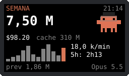 | 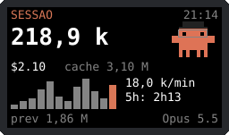 |

| Projetos | Sessões | Recordes |
| --- | --- | --- |
| 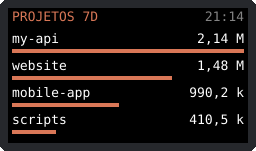 | 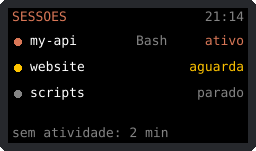 | 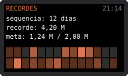 |

| Semanal | Modelos | Bichinho |
| --- | --- | --- |
| 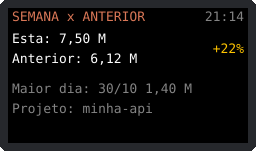 | 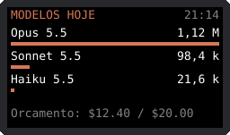 | 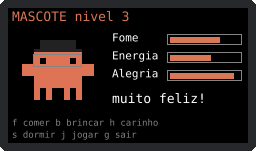 |

| Minijogo | Configurações | Redes Wi-Fi |
| --- | --- | --- |
| 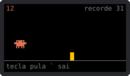 | 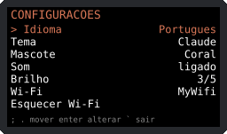 | 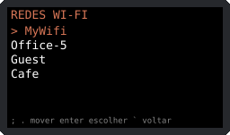 |

| Senha do Wi-Fi | Pedido de permissão |
| --- | --- |
| 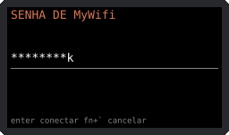 | 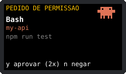 |

## Telas

| Tela | Mostra |
| --- | --- |
| Hoje, Semana, Sessão | Tokens, custo, leituras de cache, gráfico de 12 horas, ritmo, janela de 5 horas, previsão, modelo e mascote |
| Projetos | Os 4 principais projetos em 7 dias |
| Sessões | Até 4 sessões com status e ferramenta atual, e os minutos desde a última atividade |
| Recordes | Sequência, recorde diário, progresso da meta e mapa de atividade de 28 dias |
| Semanal | Esta semana contra a anterior, maior dia e principal projeto |
| Modelos | Os 3 principais modelos de hoje, e custo contra orçamento |
| Bichinho | Indicadores, humor, nível e ações |
| Configurações | Todas as opções do aparelho |

O canto superior direito mostra o horário da última atualização, `SEM DADOS` após 20 segundos sem atualização, ou `aguardando PC` antes da primeira.

## Teclas

| Tecla | Ação |
| --- | --- |
| `,` / a maioria das outras | Tela anterior / próxima |
| `o` | Configurações |
| `g` | Abre ou fecha a tela do bichinho |
| `r` | Liga ou desliga o Pomodoro |
| `t` | Próximo tema |
| `c` | Próxima cor do mascote |
| `m` | Liga ou desliga o som |
| `p` | Pausa ou retoma as atualizações do PC |
| `1` a `9` | Roda um comando da sua configuração |
| `y` `y` / `n` | Aprova / nega um pedido pendente |

**Nas configurações:** `;` e `.` movem, Enter altera ou seleciona e `` ` `` volta. Ao digitar uma senha, Enter conecta, Del apaga e `fn` + `` ` `` cancela.

## Bichinho virtual

| Tecla | Ação |
| --- | --- |
| `f` | Comer: +25 de comida, recusado se estiver cheio |
| `b` | Brincar: +20 de alegria, -10 de energia e -5 de comida; recusado se estiver exausto ou faminto |
| `h` | Carinho: +10 de alegria |
| `s` | Dorme ou acorda; acorda sozinho quando a energia enche |
| `j` | Jogo de pular: qualquer tecla pula, Enter ou Espaço recomeça, `` ` `` sai |
| `g` | Sai da tela do bichinho |

**Indicadores** vão de 0 a 100 e começam em 80:

| Indicador | Por hora |
| --- | --- |
| Comida | -6 acordado, -3 dormindo |
| Energia | -5 acordado, +30 dormindo |
| Alegria | -4 acordado, -2 dormindo; o dobro quando comida ou energia estão abaixo de 20 |

- **Como ganhar alegria:** cada ponto no jogo dá +1, até 30 por partida, e uma partida gasta 5 de energia. Um foco de Pomodoro concluído dá +5 e uma tarefa concluída pelo Claude dá +1.
- **Tempo fora:** os indicadores são atualizados quando o PC volta a se conectar por USB, até o limite de 7 dias.
- **Morte:** não existe. Ele só fica triste até receber atenção.
- **Salvamento:** no máximo a cada 10 minutos, para poupar a flash, então as últimas ações podem se perder ao desligar.

**Níveis** vêm dos tokens vistos pela USB com o aparelho ligado:

| Nível | Tokens | Libera |
| --- | --- | --- |
| 2 | 500 mil | Chapéu |
| 3 | 2 milhões | Óculos |
| 4 | 4,5 milhões | |
| 5 | 8 milhões | Coroa |

Cada nível N+1 exige 500 mil x N² tokens, até o nível 99.

## Hooks do Claude Code

Os totais de tokens funcionam sem hooks, porque vêm dos registros locais. Os hooks acrescentam status em tempo real, sessões e reações.

```bash
python3 scripts/install_hooks.py            # instala os hooks de status
python3 scripts/install_hooks.py --approve  # também permite aprovar pelo aparelho
python3 scripts/install_hooks.py --remove   # remove só os hooks deste projeto
```

O instalador edita `~/.claude/settings.json`, salva um backup ao lado como `settings.json.bak-<horário>` e mantém os hooks de outras ferramentas. Rode de novo depois de atualizar o projeto, porque novas funcionalidades podem exigir novos eventos. Os hooks novos devem valer para as próximas sessões do Claude Code.

| Evento | Efeito |
| --- | --- |
| `SessionStart` | Sessão aparece como parada |
| `UserPromptSubmit`, `PreToolUse`, `PostToolUse` | Sessão aparece trabalhando, com o nome da ferramenta |
| `PostToolUseFailure` | Trabalhando, e o mascote se assusta |
| `Notification` | `permission_prompt` mostra aguardando e `idle_prompt` mostra parada |
| `PermissionRequest` | Aguardando; com `--approve`, também pergunta ao aparelho |
| `Stop` | Parada, e o mascote comemora |
| `SessionEnd` | Sessão removida |

O hook é o `hooks/agent_hook.py` e usa só a biblioteca padrão do Python. Os erros dele vão para o stderr e não deveriam atrapalhar o Claude Code. Os hooks de status têm limite de 5 segundos, e o de aprovação, de 30.

**Arquivos de estado** ficam em `~/.cache/cardputer-token-monitor`, com permissões privadas:

| Caminho | Conteúdo |
| --- | --- |
| `sessions/<id>.json` | Estado, pasta de trabalho e ferramenta de uma sessão |
| `pending/<id>.json` | Pedido de aprovação aguardando resposta |
| `responses/<id>` | Resposta do aparelho |
| `event_done`, `event_error` | Horário da última tarefa concluída e da última ferramenta que falhou |
| `bridge.alive` | Indica que o programa do PC está rodando |

Uma sessão marcada como trabalhando e sem eventos por 10 minutos aparece como parada, e uma sem eventos por 24 horas some da lista.

## Tudo o que dá para configurar

### No aparelho (`o`)

As opções ficam salvas no aparelho e continuam valendo depois de reiniciar.

| Opção | Valores | Padrão |
| --- | --- | --- |
| Idioma | Português, English, Español | Português |
| Tema | Claude, Retro, Matrix, Oceano, Ciano, Meia-noite, Rosa, Lavanda, Algodao, Pessego | Claude |
| Cor do mascote | Coral, Azul, Ciano, Rosa, Lilás, Verde, Amarelo, Branco | Coral |
| Som | Ligado, desligado | Ligado |
| Brilho | 1 a 5 | 3 |
| Wi-Fi | Busca e escolha da rede | Nenhuma |
| Esquecer Wi-Fi | Apaga a rede e desliga a transmissão do PC | |
| PC transmite | Ligado, desligado | Desligado |
| Apagar tela | 1, 5 ou 15 minutos, nunca | 5 minutos |

A fonte não tem acentos, então os textos aparecem sem eles no aparelho.

### No PC

Crie o arquivo `~/.config/cardputer-token-monitor.json`. Ele é relido a cada ciclo, sem precisar reiniciar, e todas as chaves são opcionais.

```json
{
  "goal_daily_tokens": 2000000,
  "budget_daily_usd": 20,
  "window_warn_minutes": 30,
  "wifi_broadcast": false,
  "device_serials": ["definido pelo --pair"],
  "commands": {
    "1": ["code", "/caminho/dos/repos"],
    "2": ["playerctl", "play-pause"],
    "3": ["notify-send", "Pausa", "Hora de levantar"]
  }
}
```

| Chave | Para que serve | Padrão |
| --- | --- | --- |
| `goal_daily_tokens` | Alerta quando os tokens de hoje chegam a esse valor; `0` desliga | `0` |
| `budget_daily_usd` | Alerta quando o custo estimado de hoje chega a esse valor; `0` desliga | `0` |
| `window_warn_minutes` | Alerta quando restam esses minutos na janela de 5 horas | `30` |
| `wifi_broadcast` | Transmite os totais na rede local | `false` |
| `device_serials` | Aparelhos pareados, definidos por `--pair` e `--unpair`; mantenha ao editar | Vazio |
| `commands` | Liga as teclas `1` a `9` a um programa e seus argumentos | Vazio |

Se vários alertas valerem ao mesmo tempo, só um aparece: orçamento, depois meta, depois janela.

**Comandos** rodam sem shell, então `|`, `&&` e `~` não funcionam; se precisar deles, chame um script. Só um aparelho pareado pode rodá-los, e a tela não mostra o resultado. Programas gráficos podem não abrir quando o programa do PC roda como serviço, dependendo da sua sessão. Quem estiver com o aparelho na mão pode dispará-los, então evite comandos destrutivos.

### Opções do programa do PC

```bash
uv run --with pyserial bridge/token_bridge.py [opções]
```

| Opção | Para que serve | Padrão |
| --- | --- | --- |
| `--port PORTA` | Porta serial. Ignorada depois do pareamento, que usa o aparelho pareado | Procura um aparelho Espressif |
| `--interval SEGUNDOS` | Tempo entre atualizações | `5` |
| `--once` | Imprime um resumo e sai, sem aparelho | |
| `--pair` | Adiciona o único aparelho Espressif conectado à lista de pareados e sai | |
| `--unpair SERIAL` | Remove um aparelho da lista de pareados e sai | |
| `--wifi SSID` | Envia as credenciais de Wi-Fi pela USB e sai; exige `--port` | |

Sem pareamento nem `--port`, um aparelho encontrado automaticamente recebe só os totais.

### Inicialização automática

```bash
./scripts/install_service.sh
systemctl --user status cardputer-token-monitor
journalctl --user -u cardputer-token-monitor -f
systemctl --user restart cardputer-token-monitor
```

Pare o serviço antes de gravar o firmware, porque ele ocupa a porta serial:

```bash
systemctl --user stop cardputer-token-monitor
```

### No código-fonte

| O quê | Onde |
| --- | --- |
| Preços dos modelos | `PRICES` em `bridge/token_bridge.py` |
| Dias de histórico lidos | `RETENTION` em `bridge/token_bridge.py` (400) |
| Porta do Wi-Fi | `UDP_PORT` nos dois programas (47474) |
| Tempo até avisar que não há dados | `STALE_MS` em `firmware/src/main.cpp` (20 s) |
| Temas, cores e forma do mascote | `THEMES`, `MASCOT_COLORS`, `MASCOT` em `firmware/src/main.cpp` |
| Traduções | `STRINGS` em `firmware/src/main.cpp` |
| Duração do Pomodoro | `handleKey` e `loop` em `firmware/src/main.cpp` |
| Pinos do microSD | `SD_SCK`, `SD_MISO`, `SD_MOSI`, `SD_CS` em `firmware/src/main.cpp` |
| Espera pela aprovação | `APPROVE_SECONDS` em `hooks/agent_hook.py` (25 s) |

## Wi-Fi

1. Aperte `o`, escolha **Wi-Fi**, selecione uma rede e digite a senha.
2. Com o aparelho pareado conectado por USB, ligue **PC transmite** no mesmo menu. A escolha é reenviada até o PC confirmar, e depois disso vale o que estiver no PC. Sem pareamento, defina `wifi_broadcast` como `true` na configuração.
3. Quando o status mostrar o nome da rede, tire o cabo.

- O PC precisa continuar ligado e na mesma rede, com o programa rodando.
- A USB tem prioridade quando está conectada.
- Pelo Wi-Fi chegam só os totais: sem projetos, sessões, modelo, reações, progresso do bichinho ou aprovações.
- Redes ocultas não aparecem, e a busca mostra no máximo 6 redes.
- Roteadores com isolamento de clientes podem bloquear a transmissão.
- Para uma senha com `` ` ``, use `token_bridge.py --port /dev/ttyACM0 --wifi "MinhaRede"`.

## Histórico no microSD

Com um cartão FAT32 inserido ao ligar o aparelho, uma linha é adicionada a `/token-history.csv` quando a data muda:

```csv
2026-11-01,1234567,12.34
```

As colunas são data, tokens e custo estimado. Só dados da USB são gravados, e somente se o aparelho estiver ligado quando a data mudar.

## Aprovar pelo aparelho

**Desligado por padrão. É uma conveniência, não uma proteção de segurança.** As decisões passam por arquivos do seu usuário, então qualquer programa rodando como você, incluindo um iniciado pelo Claude, poderia falsificar uma resposta. O número de série usado no pareamento pode ser falsificado, então ele só evita confundir aparelhos. Quem estiver com o aparelho na mão pode aprovar comandos. Não ative se esses riscos importam para você.

```bash
uv run --with pyserial bridge/token_bridge.py --pair
python3 scripts/install_hooks.py --approve
```

- **O que pode ser aprovado:** só comandos Bash de até 60 caracteres ASCII imprimíveis em uma linha, sem opções extras e com nome de pasta curto, para que tudo apareça na tela. O restante só pode ser negado no aparelho ou respondido no terminal.
- **Para aprovar:** aperte `y` duas vezes em até 3 segundos. `n` nega. Outras teclas não fazem nada, e as teclas são ignoradas por 0,7 segundo depois que um pedido aparece.
- **Sem resposta ou sem o programa do PC:** a decisão volta para o terminal; nunca há aprovação automática.
- **Atraso:** cada pedido pode esperar até 25 segundos antes de chegar ao terminal.

## O que os números significam

- **Total:** entrada + saída + criação de cache. As leituras de cache aparecem à parte porque ofuscariam todo o resto.
- **Ritmo:** tokens por minuto nos últimos 5 minutos.
- **Previsão:** o total de hoje mais o ritmo da última hora por até 2 horas.
- **5h:** estimativa feita com os registros locais, a partir da hora cheia da primeira mensagem. Não é o limite real do seu plano.
- **Custo:** estimativa pelos preços de tabela, não a sua fatura. Em um plano fixo, mostra quanto o uso custaria na API. Escritas de cache contam como 1,25x a entrada para 5 minutos e 2x para 1 hora, e o modo rápido como 2x. Modelos desconhecidos contam como US$ 0, então atualize `PRICES` quando surgirem novos modelos.
- **Semana:** os últimos 7 dias, não a semana do calendário.
- **Sequência:** dias seguidos com uso. O dia de hoje só quebra a sequência quando termina.
- **Alcance:** só o Claude Code deste PC, sem claude.ai nem outras máquinas.
- **Sem porcentagem do limite do plano:** os registros locais usados aqui não trazem esse dado.

## Como funciona

```text
~/.claude/projects/**/*.jsonl ─┐
Hooks do Claude Code → arquivos de estado ┴→ bridge/token_bridge.py ─┬→ USB serial (JSON, a cada 5 s) → Cardputer
                                                                     └→ UDP broadcast, só totais      → Cardputer
Teclas do Cardputer → USB serial → programa do PC → aprovações, comandos, pausa, transmissão
```

Organização do repositório:

| Caminho | Conteúdo |
| --- | --- |
| `bridge/token_bridge.py` | Lê os registros, monta o resumo e conversa com o aparelho |
| `hooks/agent_hook.py` | Registra o estado das sessões e trata as aprovações |
| `firmware/` | Projeto PlatformIO do Cardputer |
| `scripts/` | Instaladores dos hooks e do serviço |
| `site/`, `.github/workflows/pages.yml` | Instalação pelo navegador |
| `tests/` | Testes em Python |

## Privacidade e segurança

- **Sem conta nem chave de API:** tudo vem de arquivos locais, e nada é enviado para a internet.
- **Dados pela USB:** totais, nomes de projetos e sessões, nomes de ferramentas e, com a aprovação ligada, comandos curtos. O conteúdo das conversas nunca é enviado.
- **Transmissão por Wi-Fi:** não tem autenticação. Qualquer pessoa na sua rede pode ler os totais ou falsificar o que aparece na tela, inclusive o humor do mascote. Ela nunca leva nomes de projetos nem aprovações, não faz som e nunca é gravada no microSD.
- **Senha do Wi-Fi:** fica sem criptografia no aparelho, e quem tiver acesso físico a ele pode conseguir extraí-la. Use **Esquecer Wi-Fi** antes de emprestá-lo, e lembre que backups do firmware podem conter a senha.
- **Aparelhos não pareados:** não aprovam pedidos, não rodam comandos e não mudam configurações no PC.
- **Acesso físico:** com o pareamento, quem estiver com o aparelho na mão pode disparar seus comandos configurados e, se ativadas, as aprovações.

## Solução de problemas

| Problema | O que tentar |
| --- | --- |
| `aguardando PC` ou `SEM DADOS` | Veja o programa com `systemctl --user status cardputer-token-monitor` e confira se as atualizações não foram pausadas com `p` |
| Porta ocupada ao gravar | Pare o serviço antes |
| Permissão negada na porta | Entre no grupo com `sudo usermod -aG dialout $USER` e faça login de novo |
| Aparelho não encontrado | Use um cabo de dados e conecte só um aparelho Espressif, ou use `--port` |
| Projetos e sessões vazios | Pareie o aparelho; para sessões, instale também os hooks e abra uma nova sessão do Claude Code |
| Sem reação a falhas | Rode o instalador dos hooks de novo |
| Dados errados ou ausentes no Wi-Fi | Ligue PC transmite, use a mesma rede e verifique o isolamento de clientes |
| Sem histórico no microSD | Use FAT32, com o cartão inserido antes de ligar o aparelho |
| Texto apagado em algum tema | Aperte `t`, porque Algodão é o único tema claro |
| Custo em US$ 0 | Adicione o modelo em `PRICES` |

## Desinstalação

```bash
python3 scripts/install_hooks.py --remove
systemctl --user disable --now cardputer-token-monitor
rm ~/.config/systemd/user/cardputer-token-monitor.service
rm -r ~/.cache/cardputer-token-monitor ~/.config/cardputer-token-monitor.json
uvx esptool --port /dev/ttyACM0 write-flash 0 backup/firmware-original-8MB.bin
```

## LilyGO T-Embed

Este repositório também tem firmware para o **LilyGO T-Embed** (ESP32-S3, flash de 16 MB, tela de 1,9", botão giratório e anel de LEDs), em `firmware-tembed/`. Ele usa o mesmo programa do PC e os mesmos hooks. Faça o backup da flash antes, como no Cardputer, usando `0x1000000` como tamanho:

```bash
systemctl --user stop cardputer-token-monitor
uvx esptool --port /dev/ttyACM0 read-flash 0 0x1000000 tembed-original.bin
(cd firmware-tembed && uvx --from platformio pio run -t upload --upload-port /dev/ttyACM0)
uv run --with pyserial bridge/token_bridge.py --pair
systemctl --user start cardputer-token-monitor
```

| Controle | Ação |
| --- | --- |
| Girar | Próxima tela ou opção |
| Clicar | Abre o bichinho ou escolhe a opção |
| Segurar | Abre ou fecha as configurações |

O anel de LEDs mostra o status: em movimento ao trabalhar, âmbar piscando ao aguardar, verde em tarefa concluída e vermelho em falha ou alerta.

Ele não tem teclado, então fica sem minijogo, Pomodoro, Wi-Fi, teclas de atalho, som, temas e telas Semanal e Modelos. Ele mostra pedidos de permissão, mas a resposta é no terminal, então não use `--approve` com ele. Vários aparelhos podem ser pareados, mas conecte só um por vez.

## Estado do projeto

- **Testado em aparelho real (Linux):** mascote, totais, teclas, temas, telas de Projetos e Sessões, e status do agente pelos hooks.
- **T-Embed, testado em aparelho real (Linux):** tela, botão giratório, clique e toque longo, tela do bichinho e anel de LEDs.
- **Ainda não confirmado em aparelho real:** bichinho, minijogo, acessórios, reações, Pomodoro, tempo limite da tela, telas Semanal e Modelos, configurações, idiomas, Wi-Fi, histórico no microSD, aprovação, teclas de atalho, instalação pelo navegador, Cardputer ADV, macOS e Windows.

## Desenvolvimento

```bash
uvx pytest tests                                  # testes em Python
(cd firmware && uvx --from platformio pio run)    # compila o firmware
python3 bridge/token_bridge.py --once             # mostra os dados
```

Os testes cobrem o código Python. O firmware só tem a verificação de compilação, então mudanças de tela e teclas precisam de um aparelho real.

Issues e pull requests são bem-vindos, principalmente relatos de Cardputer ADV, macOS e Windows.

## Licença

[MIT](LICENSE). Projeto independente da comunidade, sem vínculo com a Anthropic ou a M5Stack.
